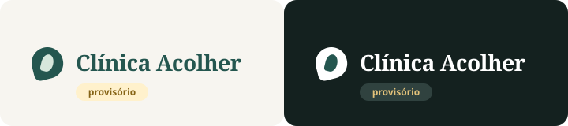

# Guia visual — Clínica Acolher

> **Rascunho v0.1 (15/11/2026)** — issue #14. Sujeito à validação com a cliente piloto (issue #13).
> Valores extraídos do protótipo do Figma Make (issue #12). A fonte única dos valores é [`design-tokens.json`](design-tokens.json); a aplicação no código fica para a issue #28.

**Essência:** acolhedor, calmo e discreto. A interface deve passar segurança e sigilo, sem chamar atenção para si.

## Paleta

| Papel | Claro | Escuro | Uso |
| --- | --- | --- | --- |
| Fundo | `#f7f5f0` | `#14211f` | Fundo da página (creme / verde-noite) |
| Superfície | `#ffffff` | `#263b37` | Cartões, painéis, modais |
| Superfície suave | `#edf5f2` | `#30423f` | Item de menu ativo, blocos de apoio |
| Primária | `#24564f` | `#79c4b1` | Botão principal, marca, item ativo |
| Primária forte | `#173f3a` | — | Títulos de página, avisos flutuantes |
| Primária média | `#327067` | — | Links, botão de texto, dia atual |
| Texto | `#20302e` | `#ffffff` | Texto principal |
| Texto suave | `#5f6f6c` | `#cfdfdc` | Descrições, legendas, ajuda |
| Borda decorativa | `#dfe7e4` | `#30423f` | Divisórias (não identifica componentes) |
| Borda de campo | `#83918e` | `#6f8a85` | Campos, rádios, botão secundário |
| Foco | `#327067` | `#9ccdc4` | Contorno de foco de 3 px |
| Perigo | `#b64a4a` | `#b24b4b` | Ação destrutiva, encerrar chamada |
| Acentos | `#ebe8f4` `#f6e8dd` `#fff4d8` | — | Ícones de métricas e cartões de sessão (só decorativo) |

**Estados** (texto sobre fundo próprio):

| Estado | Claro | Escuro (texto sobre superfície) |
| --- | --- | --- |
| Sucesso | `#2e6a58` sobre `#e4f2eb` | `#8fc9a8` |
| Atenção | `#866416` sobre `#fff1cc` | `#e3c27a` |
| Erro | `#8b3f39` sobre `#fff4f2` | `#e9a5a5` |
| Informação | `#4a7189` sobre `#e7f0f6` | `#8fb8d1` |
| Neutro | `#596d68` sobre `#edf2f0` | `#cfdfdc` |

Cor nunca é o único sinal: todo estado vem acompanhado de texto ou ícone.

## Tipografia

Google Fonts, gratuitas: **Lora** (títulos, 500–600) e **DM Sans** (interface, 400–700).

| Estilo | Fonte | Tamanho / peso / linha |
| --- | --- | --- |
| Título da página | Lora | 30 px / 600 / 1,15 |
| Título de seção | Lora | 20 px / 600 / 1,25 |
| Título de bloco | Lora | 17 px / 600 / 1,3 |
| Corpo | DM Sans | 14 px / 400 / 1,5 |
| Rótulo e botão | DM Sans | 13 px / 700 / 1,4 |
| Pequeno | DM Sans | 12 px / 400 / 1,5 |

Tamanho mínimo: **12 px**. O protótipo usa 8–10 px em legendas; na implementação (#28), esses textos sobem para 12 px.

## Logo provisório

Arquivo: [`imagens/logo-provisorio.svg`](imagens/logo-provisorio.svg). Folha arredondada com broto (o mesmo símbolo do protótipo) e o nome em Lora. No fundo claro usa a primária; no escuro, branco. Leva a etiqueta **"provisório"** até haver uma marca definitiva aprovada.

## Tom de voz

| Princípio | Faça | Evite |
| --- | --- | --- |
| Acolher sem infantilizar | "Sua consulta está confirmada para terça, 18/11, às 14h." | "Oba! Tudo certinho com sua consultinha! 🎉" |
| Ser claro e direto | "E-mail ou senha incorretos. Confira e tente de novo." | "Erro 401: credenciais inválidas." |
| Não culpar a pessoa | "Não conseguimos confirmar o pagamento. Você pode tentar outra forma." | "Você errou os dados do cartão." |
| Lembrar sem pressionar | "Há uma cobrança pendente de R$ 150,00 (sessão de 04/11). Pague quando puder pelo Pix ou cartão." | "ATENÇÃO: débito em aberto! Regularize imediatamente." |
| Discrição sempre | "Você tem uma sessão às 14h." | "Sessão de terapia de Ana Exemplo às 14h" em notificações visíveis a terceiros |
| Dizer o próximo passo | "Consulta cancelada. Quer escolher outro horário?" | "Operação concluída." |
| Tratar com respeito | Usar "você" e frases completas | Gírias, ironia, pontos de exclamação em série |

Todos os nomes e valores acima são fictícios.

## Contraste (WCAG 2.1 AA)

Mínimos: **4,5:1** para texto normal, **3:1** para texto grande (≥ 24 px, ou ≥ 18,66 px em negrito) e para componentes de interface e foco.

| Tema | Frente sobre fundo | Razão | AA |
| --- | --- | --- | --- |
| Claro | Texto sobre fundo / superfície | 12,65 / 13,78 | ✅ |
| Claro | Texto suave sobre fundo / superfície / superfície suave / lateral | 4,85 / 5,28 / 4,76 / 5,13 | ✅ |
| Claro | Rótulo sobre superfície | 8,27 | ✅ |
| Claro | Primária sobre fundo / superfície suave | 7,65 / 7,52 | ✅ |
| Claro | Primária forte sobre fundo (título) | 10,66 | ✅ |
| Claro | Primária média sobre superfície / fundo | 5,75 / 5,28 | ✅ |
| Claro | Branco sobre primária / média / forte | 8,34 / 5,75 / 11,61 | ✅ |
| Claro | Branco sobre perigo | 5,16 | ✅ |
| Claro | Sucesso / atenção / erro / informação / neutro | 5,48 / 4,86 / 6,79 / 4,53 / 4,87 | ✅ |
| Claro | Borda de campo sobre superfície / fundo | 3,28 / 3,01 | ✅ |
| Claro | Foco sobre fundo / superfície | 5,28 / 5,75 | ✅ |
| Escuro | Texto sobre fundo / superfície | 16,57 / 11,91 | ✅ |
| Escuro | Texto suave sobre fundo / superfície / elevada | 12,03 / 8,64 / 7,71 | ✅ |
| Escuro | Primária sobre fundo / superfície | 8,16 / 5,87 | ✅ |
| Escuro | Fundo sobre primária (botão) | 8,16 | ✅ |
| Escuro | Branco sobre perigo | 5,25 | ✅ |
| Escuro | Sucesso / atenção / erro / informação / neutro sobre superfície | 6,29 / 6,96 / 5,89 / 5,64 / 8,64 | ✅ |
| Escuro | Borda de campo sobre superfície / fundo | 3,20 / 4,46 | ✅ |
| Escuro | Foco sobre fundo / superfície | 9,43 / 6,77 | ✅ |

**Cores ajustadas em relação ao protótipo** (ajuste mínimo, mantendo o tom):

| Papel | Original → ajustada | Motivo |
| --- | --- | --- |
| Texto suave | `#687976` → `#5f6f6c` | 4,20:1 sobre o creme |
| Borda de campo | `#cdd9d6` → `#83918e` | 1,45:1 sobre branco |
| Foco | `#9ccdc4` → `#327067` | 1,61:1 sobre o creme |
| Informação (texto) | `#5784a0` → `#4a7189` | 3,49:1 sobre o fundo informativo |

O tema escuro parte da sala de vídeo do protótipo (`#14211f`, `#263b37`, `#30423f`, `#79c4b1`, `#9ccdc4`, `#cfdfdc`, `#b24b4b`). Borda de campo e textos de estado do tema escuro são **novos** e precisam de validação.

**Verificação automática:** `frontend/src/app/design/contraste.spec.ts` lê os pares de `design-tokens.json` e falha se algum ficar abaixo do mínimo. Para incluir uma combinação nova, acrescente o par em `contraste.pares`.

## Regra relacionada

`RN-SEG-13` — Acessibilidade: navegação por teclado, contraste adequado, textos alternativos e compatibilidade com leitores de tela (WCAG 2.1 nível AA como meta). Ver [Regras de negócio](Regras%20de%20negocio.md).
