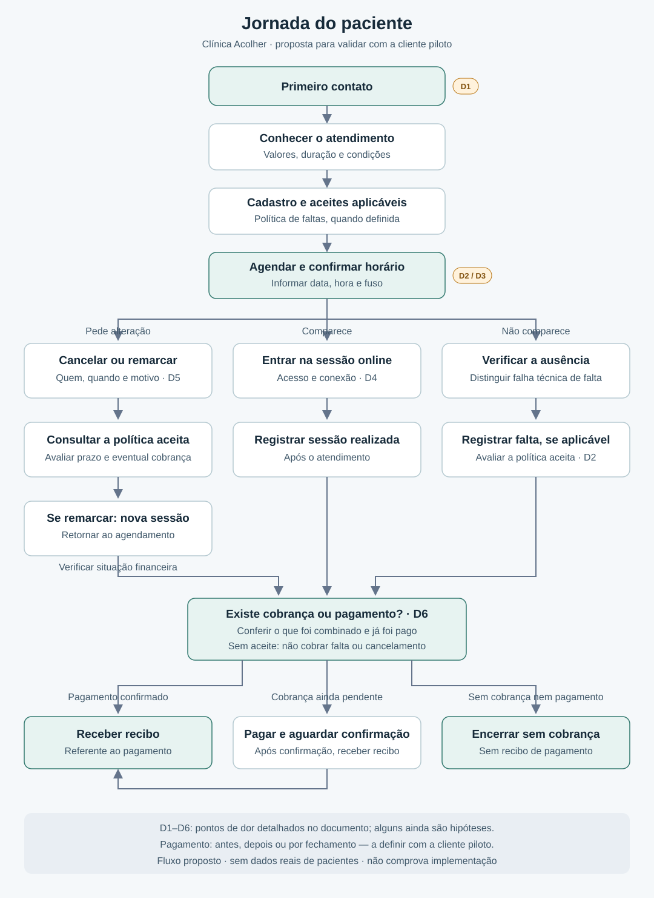

# Jornada do paciente — Clínica Acolher

**Situação:** proposta para validar com a cliente piloto.  
**Objetivo:** descrever o caminho do primeiro contato ao recibo e identificar dificuldades, sem usar dados reais de pacientes.

Este documento descreve a experiência desejada. Não significa que todas as funcionalidades já estejam implementadas ou aprovadas para o piloto.

## Fluxo visual

[Abrir ou baixar a imagem em SVG](imagens/jornada-paciente.svg). A imagem é vetorial e pode ser ampliada sem perder qualidade.

**Como ler:** os marcadores D1 a D6 apontam dificuldades descritas na tabela abaixo. O pagamento pode acontecer antes da sessão, depois ou no fechamento mensal; a posição da verificação financeira no desenho não define quando cobrar.

## Caminho do paciente

1. **Primeiro contato:** conhecer o atendimento e pedir informações.
2. **Informações iniciais:** entender modalidade, valores, duração, disponibilidade e condições de cancelamento.
3. **Cadastro e condições:** registrar os dados necessários e os aceites aplicáveis, incluindo a versão da política de faltas quando definida.
4. **Agendamento:** combinar um horário e receber sua confirmação, com o fuso indicado.
5. **Comparecimento:** acessar a sessão online e realizar o atendimento. Uma falha técnica precisa ser distinguida de uma falta do paciente.
6. **Cancelamento ou remarcação:** registrar o pedido, o motivo, quem pediu e a antecedência. Na remarcação, preservar a sessão anterior e criar outra; voltar ao agendamento.
7. **Falta:** registrar a ausência somente após o início previsto e avaliar a política aceita. Sem aceite registrado, não prever cobrança de falta ou cancelamento.
8. **Verificação financeira:** verificar se existe cobrança aplicável e se o pagamento já foi confirmado, conforme a modalidade combinada. Cancelamento ou remarcação não implica cobrança automática.
9. **Recibo:** disponibilizar o recibo referente ao pagamento confirmado. Quando não houver cobrança nem pagamento associado, encerrar sem recibo de pagamento.

## Pontos de dor

| Código | Etapa | Dificuldade | Evidência atual | Pergunta para validar |
| --- | --- | --- | --- | --- |
| D1 | Primeiro contato | Dificuldade de captar novos pacientes. | Preocupação relatada na entrevista; a experiência do paciente nessa etapa ainda precisa ser detalhada. | Como as pessoas encontram você e quais dúvidas aparecem antes de marcar? |
| D2 | Agendamento e comparecimento | Comprometimento do paciente com as sessões. | Preocupação relatada na entrevista, sem causas detalhadas. | O problema mais comum é esquecer, desmarcar em cima da hora ou não comparecer? |
| D3 | Agendamento | Troca de muitas mensagens para encontrar um horário. | Hipótese a validar. | Quantas mensagens normalmente são necessárias para combinar uma sessão? |
| D4 | Sessão online | Dificuldade para encontrar o acesso ou entrar na sessão. | Hipótese a validar. | O que acontece quando o paciente não consegue entrar ou perde a conexão? |
| D5 | Cancelamento e remarcação | Dúvida sobre prazo, nova data e eventual cobrança. | Hipótese a validar. | Como essas condições são explicadas e como o paciente confirma que entendeu? |
| D6 | Pagamento e recibo | Dúvida sobre confirmação de pagamento e necessidade de pedir o recibo. | Hipótese a validar. | Como o paciente paga, recebe a confirmação e obtém o recibo hoje? |

## Decisões ainda pendentes

- Momento do pagamento em cada modalidade: por sessão, mensal ou pacote.
- Antecedência mínima e condições da política de faltas e cancelamentos.
- Canal usado para o primeiro contato, confirmação e pedidos de alteração.
- Forma de acesso à sessão durante o piloto e procedimento em caso de falha técnica.
- Quem emite o recibo, como ele é entregue e quais etapas serão manuais no piloto.
- Particularidades do atendimento a menores e de pacientes em outros fusos.

## Roteiro de validação

Peça à cliente piloto que percorra o fluxo usando um exemplo fictício. Para cada etapa, registre como ela funciona hoje, onde há demora ou confusão e como deveria funcionar no piloto. Diferencie dificuldades confirmadas de hipóteses.

| Registro | Preencher após a conversa |
| --- | --- |
| Data da validação | Pendente |
| Participante | Cliente piloto, sem dados de pacientes |
| Alterações solicitadas | Pendente |
| Pontos de dor confirmados | Pendente |
| Decisões tomadas | Pendente |

## Acompanhamento da tarefa

- [x] Fluxo inicial desenhado e imagem vinculada ao documento.
- [x] Pontos de dor marcados, distinguindo relatos de hipóteses.
- [x] Resultado registrado em `docs/`, sem dados reais de pacientes.
- [ ] Fluxo confrontado com a rotina atual da cliente piloto.

As melhorias identificadas podem virar tarefas separadas. Este mapeamento não comprova a implementação das funcionalidades nem substitui a aprovação do escopo do piloto.
