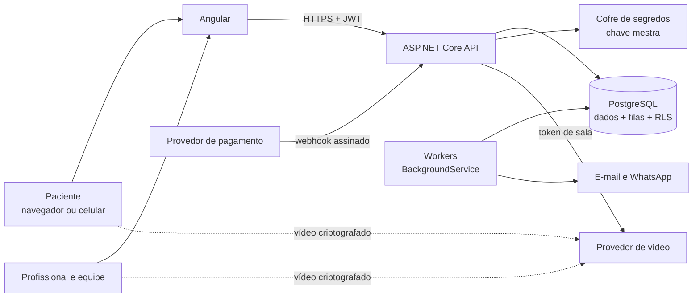

# PROJETO.md — Clínica Acolher

> Documento técnico mestre. Versão 2.0 · 2026-11-09
> Substitui o PROJETO.md do PsicoGest (Java/React).

---

## 1. Sobre este documento

O projeto tem três fontes de verdade, cada uma com um papel:

| Fonte | Responde | Onde fica |
|---|---|---|
| **Regras de negócio** | *O quê* o sistema faz e por quê (regras `RN-...`, leis aplicáveis) | `docs/regras-de-negocio.md` |
| **PROJETO.md** (este arquivo) | *Como* o sistema é construído (arquitetura, padrões, decisões técnicas) | raiz do repositório |
| **Backlog no GitHub** | *Quando* e *quem* (issues, milestones M0 a M15, Project) | GitHub Issues e Projects |

Em caso de conflito sobre comportamento, valem as **regras de negócio**. Em caso de conflito sobre implementação, vale **este documento**. Decisões que mudam qualquer um dos dois são registradas como ADR em `docs/decisoes/`.

Este documento não repete as regras de negócio: ele cita os códigos (`RN-AGD-03`) e explica como cada uma é garantida tecnicamente.

---

## 2. Produto

A **Clínica Acolher** é uma clínica online para psicanalistas e, depois, outros profissionais de saúde mental. O paciente agenda, paga e faz a sessão por vídeo dentro da plataforma. O profissional gerencia agenda, financeiro e anotações no mesmo lugar. Sessões presenciais também são suportadas.

### 2.1 Fases

| Fase | Quem usa | Papel da plataforma na LGPD |
|---|---|---|
| 1. Piloto | A clínica da família, com acompanhamento próximo | Operadora |
| 2. SaaS | Clínicas e profissionais assinantes | Operadora |
| 3. Marketplace (futuro, não planejado) | Pacientes buscando profissionais | Passa a ser também controladora; exige nova análise jurídica |

### 2.2 O que a plataforma não é

- Não presta atendimento clínico: quem atende é o profissional (`RN-GER-01`).
- Não é serviço de emergência (`RN-GER-03`).
- Não usa dado clínico para marketing, análise comercial ou treinamento de IA (`RN-GER-04`).

---

## 3. Status atual

Em 2026-11-09:

| Item | Situação |
|---|---|
| Regras de negócio | 🟡 Rascunho, aguardando validação com a cliente piloto e com advogado |
| Arquitetura (este documento) | 🟡 Definida, ajustável durante a construção |
| Backlog no GitHub | 🟡 Script pronto (`criar-tarefas-github.sh`), execução pendente |
| Backend .NET | ❌ Não iniciado |
| Frontend Angular | ❌ Não iniciado |
| CI/CD | ❌ Não iniciado |
| Infraestrutura | ❌ Não iniciada |

Legenda usada em todo o projeto: ✅ implementado e testado · 🟡 parcial ou em andamento · ❌ não iniciado · 🚨 bloqueia o piloto.

**Nunca marcar ✅ algo que foi apenas planejado.**

---

## 4. Princípios inegociáveis

1. **Sigilo por padrão.** Sessões nunca são gravadas. Notificações nunca revelam o motivo do atendimento. Logs nunca contêm conteúdo clínico.
2. **Dado clínico pertence ao vínculo paciente ↔ profissional**, nunca à clínica ou à organização. Ser administrador não dá acesso clínico.
3. **Autorização sempre no servidor, por recurso.** Estar logado não basta: cada requisição prova que pode acessar *aquele* paciente.
4. **Nada importante é apagado.** Desativa-se, bloqueia-se, corrige-se com um novo registro. Histórico é imutável.
5. **Cobrança, pagamento e documento fiscal são coisas diferentes** e vivem em entidades diferentes.
6. **Regras de negócio moram no domínio**, em um único lugar, cobertas por testes que citam o código da regra.
7. **Minimização de dados.** Só se coleta o que tem finalidade clara, no momento em que ela surge.
8. **Somente dados fictícios** em desenvolvimento, testes, demonstração e documentação.
9. **Segurança antes de funcionalidade.** Enquanto houver item 🚨, nenhuma funcionalidade nova entra.
10. **Construir pequeno e provar.** Cada etapa termina compilando, testada e entendida antes da próxima começar.

---

## 5. Stack

### 5.1 Backend

| Tecnologia | Uso |
|---|---|
| C# / .NET 10 (LTS) | Linguagem e plataforma |
| ASP.NET Core Web API (controllers) | API HTTP |
| ASP.NET Core Identity | Usuários, hash de senha, bloqueio por tentativas, 2FA por aplicativo (TOTP) |
| JWT Bearer | Token de acesso de curta duração |
| Entity Framework Core + Npgsql | Acesso ao banco e migrations |
| PostgreSQL 17+ | Banco de dados principal (inclui filas simples e RLS) |
| FluentValidation | Validação de entrada |
| `BackgroundService` | Tarefas em segundo plano (lembretes, webhooks, retenção) |
| xUnit + Testcontainers | Testes unitários e de integração |
| OpenTelemetry | Métricas, logs e rastreamento |

Redis **não** entra no início: filas e limites de requisição começam no próprio PostgreSQL e na memória. Ele é adicionado quando houver mais de uma instância da API.

### 5.2 Frontend

| Tecnologia | Uso |
|---|---|
| Angular (versão estável atual) | Aplicação web (standalone components) |
| TypeScript (modo estrito) | Linguagem |
| Signals | Estado reativo |
| Reactive Forms tipados | Formulários e validação |
| HttpClient + interceptors | Comunicação com a API |
| Tailwind CSS | Estilos e tokens de design |
| Vitest | Testes unitários |
| Playwright | Testes de ponta a ponta |

### 5.3 Infraestrutura e entrega

| Tecnologia | Uso |
|---|---|
| Docker e Docker Compose | Ambiente local e imagens de produção |
| GitHub Actions | CI/CD |
| GitHub Issues e Projects | Backlog e acompanhamento |
| Nuvem com região no Brasil | Hospedagem (provedor a decidir em ADR; preferir região São Paulo) |
| Cofre de segredos do provedor de nuvem | Senhas, chaves e chave mestra de criptografia |

### 5.4 Decisões ainda abertas

Cada uma vira um ADR quando decidida.

| Decisão | Etapa | Bloqueia |
|---|---|---|
| Provedor de vídeo (WebRTC auto-hospedado, como LiveKit ou Jitsi, ou serviço gerenciado) | M6 | Atendimento online |
| Provedor de pagamentos | M7 | Cobrança online |
| Provedor de nuvem | M12 | Staging e produção |
| Provedor de e-mail e de WhatsApp | M10 | Lembretes |
| Anotações clínicas no piloto ou depois | M0 | Escopo do M8 |

---

## 6. Arquitetura



Pontos importantes:

- O vídeo **não passa pela API**: a API só emite um token curto que permite entrar naquela sala.
- Webhooks de pagamento entram numa **caixa de entrada** (tabela) e são processados por um worker; nunca alteram dados direto na requisição.
- Mensagens a enviar entram numa **caixa de saída** (tabela) e um worker envia, com nova tentativa em caso de falha.
- A API e os workers podem rodar no mesmo processo no piloto e ser separados depois.

---

## 7. Estrutura do repositório

```text
clinica-acolher/
├── backend/
│   ├── ClinicaAcolher.slnx
│   ├── Directory.Build.props
│   ├── src/
│   │   ├── ClinicaAcolher.Domain/          regras de negócio puras
│   │   ├── ClinicaAcolher.Application/     casos de uso, DTOs, interfaces
│   │   ├── ClinicaAcolher.Infrastructure/  EF Core, provedores externos, criptografia
│   │   └── ClinicaAcolher.Api/             controllers, autenticação, configuração
│   └── tests/
│       ├── ClinicaAcolher.UnitTests/
│       ├── ClinicaAcolher.IntegrationTests/
│       └── ClinicaAcolher.ArchitectureTests/   garante a regra de dependência
├── frontend/
│   └── src/app/
│       ├── core/        autenticação, interceptors, guards, layout, cliente da API
│       ├── features/    uma pasta por área do sistema
│       └── shared/      componentes, pipes e utilitários reutilizáveis
├── e2e/                 testes Playwright
├── docs/
│   ├── regras-de-negocio.md
│   ├── decisoes/        ADRs numerados (0001-provedor-de-video.md)
│   ├── runbooks/        o que fazer quando algo dá errado
│   └── lgpd/            registro de tratamento, RIPD, lista de operadores
├── .github/
│   ├── workflows/
│   ├── ISSUE_TEMPLATE/
│   └── pull_request_template.md
├── docker-compose.yml
├── .env.example
├── PROJETO.md
├── README.md
├── CONTRIBUTING.md
├── SECURITY.md
└── PILOT_FEEDBACK.md
```

Namespaces e nomes de projeto usam `ClinicaAcolher` (sem hífen nem acento). Pastas e repositório usam `clinica-acolher`.

---

## 8. Backend

### 8.1 Camadas e dependências

```text
Api ──────────► Application ──► Domain
Infrastructure ─► Application ──► Domain
```

| Camada | Contém | Não pode |
|---|---|---|
| Domain | Entidades, value objects, enums, máquinas de estado, `DomainException` | Referenciar qualquer outro projeto ou pacote de infraestrutura |
| Application | Casos de uso, DTOs, validação de entrada, interfaces (`IPatientRepository`, `IVideoProvider`, `IFieldEncryptor`) | Conhecer EF Core, HTTP ou provedores concretos |
| Infrastructure | `DbContext`, migrations, repositórios, criptografia, clientes de provedores | Conter regra de negócio |
| Api | Controllers, autenticação, middlewares, `Program.cs` | Conter regra de negócio ou acessar o `DbContext` direto |

Um teste de arquitetura no CI falha se alguém quebrar essas dependências.

### 8.2 Padrões do domínio

- **Entidades ricas:** propriedades com `private set`; mudanças só por métodos com nome de negócio (`appointment.Confirm()`, `patient.Deactivate(motivo, agora)`).
- **Criação por fábrica:** construtor privado e método estático `Create(...)` que valida. Uma entidade nunca nasce inválida.
- **Value objects** para conceitos com validação própria: `Email`, `PhoneNumber`, `Money`, `TimeRange`.
- **Erros de regra** lançam `DomainException(codigoRegra, mensagem)`. O código (`RN-AGD-08`) chega até a resposta da API e aos testes.
- **Tempo injetado:** nada chama `DateTime.Now`. O horário vem de `TimeProvider`, para que os testes controlem o relógio.
- **Identificadores** são `Guid` versão 7 (`Guid.CreateVersion7()`), ordenados por tempo.

### 8.3 Casos de uso

Cada operação do sistema é um caso de uso na Application (ex.: `CreatePatient`, `ConfirmAppointment`), com:

1. validação da entrada (FluentValidation);
2. verificação de autorização por recurso;
3. carregamento das entidades;
4. chamada dos métodos de domínio;
5. gravação em uma única transação;
6. registro de auditoria quando envolver dado clínico.

---

## 9. Modelo de domínio

### 9.1 Contextos e entidades

| Contexto | Entidades principais | Regras |
|---|---|---|
| Identidade e acesso | `User`, `UserSession`, `RefreshToken`, `SecurityEvent`, `SupportAccessGrant` | `RN-SEG`, `RN-PER-03` |
| Organização | `Organization`, `OrganizationMembership`, `Clinic`, `Room` | Seção 2, `RN-AGD-04` |
| Pessoas | `Patient`, `Guardian`, `EmergencyContact`, `Professional`, `ClinicMembership`, `ClinicMembershipPeriod` | `RN-PAC`, `RN-PRO` |
| Vínculo | `TherapeuticRelationship` | `RN-PER-01`, `RN-PER-04` |
| Agenda | `Availability`, `AvailabilityBlock`, `AppointmentSeries`, `Appointment`, `AttendancePolicy`, `AttendancePolicyAcceptance` | `RN-AGD`, `RN-CAN` |
| Atendimento online | `VideoRoom`, `VideoParticipation` | `RN-ONL` |
| Financeiro | `Price`, `Receivable`, `Payment`, `PaymentAllocation`, `Refund`, `CreditEntry`, `Receipt`, `ServiceInvoice` | `RN-FIN` |
| Pacotes | `PackagePlan`, `PackagePlanVersion`, `PatientPackage`, `SessionCreditEntry` | `RN-PCT` |
| Clínico | `ClinicalNote`, `ClinicalNoteRevision`, `ClinicalNoteAddendum` | `RN-PRT` |
| Auditoria | `AuditLog` | `RN-PRT-05`, `RN-SEG-08` |
| Privacidade | `LegalDocument`, `DocumentAcceptance`, `ConsentRecord`, `DataSubjectRequest`, `LegalHold` | `RN-LGPD`, `RN-DOC` |
| Notificações | `NotificationPreference`, `OutboxMessage`, `MessageTemplate` | `RN-NOT` |
| SaaS | `SaasPlan`, `SaasPlanVersion`, `SaasSubscription`, `SaasInvoice` | `RN-FIN-16` |

Mudanças em relação ao PsicoGest:

- `Psychoanalyst` passa a ser **`Professional`** com uma categoria (psicanalista, psicólogo, outra), porque a plataforma pode receber outros profissionais (`RN-PRO-02`).
- `MedicalRecord` passa a ser **`ClinicalNote`**: psicanálise não é ato médico, e o nome deve refletir isso.
- Entram `Guardian`, `EmergencyContact`, `VideoRoom`, `AttendancePolicy` e `DocumentAcceptance`, exigidos pela clínica online.

### 9.2 Máquinas de estado

Estados finais nunca voltam. Correções são novos registros.

**Sessão (`Appointment`)** — `RN-AGD-08`

| De | Para |
|---|---|
| `Scheduled` | `Confirmed`, `Completed`, `NoShow`, `Cancelled`, `Rescheduled` |
| `Confirmed` | `Completed`, `NoShow`, `Cancelled`, `Rescheduled` |
| `Completed`, `NoShow`, `Cancelled`, `Rescheduled` | — (finais) |

**Vínculo terapêutico (`TherapeuticRelationship`)**

| De | Para |
|---|---|
| `Active` | `Suspended`, `Ended` |
| `Suspended` | `Active`, `Ended` |
| `Ended` | — (final) |

**Anotação clínica (`ClinicalNote`)** — `RN-PRT-03`

| De | Para |
|---|---|
| `Draft` | `Finalized` |
| `Finalized` | — (final; correção por adendo) |

**Cobrança (`Receivable`)** — `RN-FIN-01`, `RN-FIN-08`

| De | Para |
|---|---|
| `Open` | `PartiallyPaid`, `Paid`, `Cancelled` |
| `PartiallyPaid` | `Paid`, `CancellationPending` |
| `CancellationPending` | `Cancelled` (após estorno ou crédito) |
| `Paid`, `Cancelled` | — (finais) |

"Vencida" não é estado: é calculado comparando o vencimento com a data atual.

**Pagamento (`Payment`)** — `RN-FIN-07`

| De | Para |
|---|---|
| `Pending` | `Confirmed`, `Failed`, `Cancelled` |
| `Confirmed` | `PartiallyRefunded`, `Refunded` |
| `PartiallyRefunded` | `Refunded` |
| `Failed`, `Cancelled`, `Refunded` | — (finais) |

**Assinatura do SaaS (`SaasSubscription`)**

`Trialing` → `Active` → `PastDue` → `Restricted` → `Cancelled`. Nenhum estado apaga dados; `Restricted` bloqueia uso novo, mas mantém a exportação.

---

## 10. Persistência

| Regra | Como |
|---|---|
| Schema | Só por migrations do EF Core. Nunca `EnsureCreated()` fora de testes descartáveis |
| Migration aplicada | Nunca é alterada. Mudança nova = migration nova |
| Recursos do PostgreSQL | Extensões, `EXCLUDE`, RLS e permissões via `migrationBuilder.Sql(...)` |
| Datas e horas | `timestamptz`, sempre em UTC. `DateOnly` para datas sem hora (nascimento) |
| Dinheiro | `decimal` no C#, `numeric(12,2)` no banco, moeda BRL |
| Enums | Gravados como texto |
| Concorrência | Controle otimista usando a coluna de sistema `xmin` |
| Conflito de agenda | `EXCLUDE USING gist` com `btree_gist` por profissional e por sala (`RN-AGD-03`, `RN-AGD-04`) |
| Exclusão | Sem `DELETE` em entidades com histórico; desativação, bloqueio ou anonimização |
| Campos cifrados | Guardados como `bytea`, com o identificador da chave usada |

### 10.1 Usuários do banco

| Usuário | Permissões |
|---|---|
| `app_runtime` | Leitura e escrita nas tabelas da aplicação; sem DDL, sem `SUPERUSER`, sem `BYPASSRLS`; só `INSERT` em `audit_log` |
| `migration_service` | DDL, usado apenas pelo pipeline |
| `backup_service` | Leitura para backup |

---

## 11. API

- REST sob `/api/v1`. Rotas e código em inglês (`/api/v1/patients`); textos visíveis ao usuário em português.
- Erros no formato **ProblemDetails** (RFC 9457), com o campo `code` trazendo a regra violada (`RN-CAN-02`) e `traceId` para suporte.
- Nunca expor stack trace, SQL ou detalhes internos fora de desenvolvimento.
- Paginação com `page` e `pageSize` (máximo 100); listas grandes migram para paginação por cursor.
- `POST` que movimenta dinheiro exige cabeçalho `Idempotency-Key`.
- Dados pessoais nunca em query string, porque aparecem em logs de servidores e proxies.
- Documentação OpenAPI disponível só em desenvolvimento.
- Códigos de status: 400 entrada inválida · 401 não autenticado · 403 sem permissão · 404 inexistente **ou sem permissão para saber que existe** · 409 conflito (agenda, concorrência) · 422 regra de negócio violada · 429 limite excedido.

---

## 12. Frontend

- Componentes standalone e rotas com carregamento sob demanda por feature.
- Estado com signals; services por feature; nenhum estado global desnecessário.
- Cliente da API tipado em `core/api`, espelhando os DTOs do backend.
- **Token de acesso só em memória.** O refresh token fica em cookie `HttpOnly`, `Secure`, `SameSite=Strict`, restrito ao caminho de autenticação. Nada de token em `localStorage`.
- Nenhum dado clínico em cache local, `localStorage`, IndexedDB ou service worker.
- Acessibilidade WCAG 2.1 AA como meta: teclado, foco visível, contraste, rótulos e leitores de tela (`RN-SEG-13`).
- Idioma pt-BR; datas e moeda formatadas em pt-BR; horários no fuso de quem vê, com o fuso indicado quando diferente (`RN-AGD-09`).
- Toda tela tem estados de carregando, vazio e erro.
- Telas do paciente exibem CVV 188 e SAMU 192 de forma discreta (`RN-GER-03`).

---

## 13. Segurança

### 13.1 Autenticação

- ASP.NET Core Identity para usuários, hash de senha, bloqueio por tentativas e 2FA por aplicativo.
- Senha com no mínimo 10 caracteres; checagem contra senhas vazadas conhecidas quando possível.
- Token de acesso JWT de 15 minutos, assinado com chave assimétrica (RS256), com claims mínimas: `sub`, `sid`, `roles`, `iat`, `exp`, `iss`, `aud`. Nada de CPF, nome de paciente ou dado clínico no token.
- Refresh token opaco, aleatório, guardado só como hash e **rotativo**: cada uso gera um novo; reuso de um antigo revoga a família inteira e gera evento de segurança.
- Sessões por dispositivo; sair de um ou de todos (`RN-SEG-04`).
- 2FA obrigatório para a equipe (`RN-SEG-03`, `RN-PRO-07`), com códigos de recuperação de uso único.

### 13.2 Autorização

- Policies do ASP.NET Core com handlers por recurso.
- Acesso a dado clínico exige `TherapeuticRelationship` ativo, ou encerrado com leitura apenas do que o próprio profissional escreveu (`RN-PER-04`).
- Papéis administrativos nunca abrem dado clínico.
- Testes automatizados tentam acessar recursos alheios em todos os endpoints (`RN-SEG-05`).

### 13.3 Isolamento entre organizações

Três camadas, porque uma falha aqui é o pior incidente possível (`RN-SEG-06`):

1. `ITenantContext` por requisição, derivado do usuário autenticado.
2. Filtro global do EF Core por `OrganizationId`.
3. **Row-Level Security** no PostgreSQL, com a organização definida na conexão por um interceptor. Mesmo um bug no código não atravessa a barreira.

### 13.4 Criptografia de campos

- Anotações clínicas e contatos de emergência são cifrados antes de gravar (`RN-PRT-02`, `RN-SEG-07`).
- AES-256-GCM com **envelope**: cada registro usa uma chave de dados aleatória, cifrada pela chave mestra guardada no cofre do provedor de nuvem.
- Dados autenticados adicionais ligam o texto cifrado ao registro certo, o que impede copiar um conteúdo cifrado para outro paciente.
- A Domain não conhece criptografia; a Application usa a interface `IFieldEncryptor`.

### 13.5 Auditoria

- `AuditLog` só aceita inserção. Cada registro guarda um HMAC encadeado com o anterior; qualquer alteração ou remoção quebra a cadeia e é detectada.
- Registra quem, o quê, qual paciente, quando, de qual sessão e com que resultado. Nunca o conteúdo clínico.
- A chave do HMAC fica no cofre, fora do banco.

### 13.6 Proteções gerais

- HTTPS obrigatório, HSTS, CSP restritiva, `X-Content-Type-Options` e `Referrer-Policy`.
- Limite de requisições em login, recuperação de senha, exportações e envio de mensagens.
- Logs estruturados com filtro de campos sensíveis (`RN-SEG-09`).
- Segredos só no cofre ou em user-secrets no desenvolvimento (`RN-SEG-10`).
- Dependências verificadas no CI e pelo Dependabot (`RN-SEG-12`).

---

## 14. Atendimento online

```text
Paciente/Profissional ─► API: "quero entrar na sessão X"
API: verifica autorização, janela de horário e estado da sessão
API ─► Provedor de vídeo: cria a sala (uma vez) e emite token de 5 min para esta pessoa
Navegador ─► Provedor de vídeo: entra na sala com o token
Provedor ─► API (webhook): entrou, saiu, qualidade → VideoParticipation
```

- Interface `IVideoProvider` na Application; a implementação concreta fica na Infrastructure, para trocar de provedor sem mudar o resto.
- Sala exclusiva por sessão, sem link reutilizável (`RN-ONL-01`, `RN-ONL-02`).
- Sala de espera: o profissional libera a entrada (`RN-ONL-03`).
- **Gravação desligada na configuração do provedor e ausente da interface** (`RN-ONL-04`). Um teste verifica a configuração.
- Só metadados são guardados, por 6 meses (`RN-ONL-06`).
- Antes de cada sessão online, o paciente confirma a cidade (`RN-ONL-09`); o acesso do profissional ao contato de emergência é auditado (`RN-ONL-10`).
- Preferência por provedor com servidores no Brasil; caso contrário, cláusulas de transferência internacional (`RN-LGPD-09`).

---

## 15. Pagamentos e webhooks

```text
Provedor ─► POST /api/v1/webhooks/{provedor}
   1. valida assinatura e horário (rejeita replay)
   2. grava em webhook_inbox (o id do evento é único)
   3. responde 200 imediatamente
Worker ─► lê a caixa de entrada ─► aplica no domínio em transação ─► marca como processado
```

- Evento repetido não duplica nada, porque o id do evento é único na caixa de entrada (`RN-FIN-07`).
- A plataforma nunca guarda número de cartão (`RN-FIN-03`).
- Interface `IPaymentProvider` com uma implementação por provedor.

---

## 16. Notificações

- Casos de uso gravam a mensagem em `outbox_message` **na mesma transação** da mudança que a originou. Um worker envia depois.
- Assim, nenhuma mensagem é perdida e nenhuma é enviada sobre algo que não chegou a ser gravado.
- Modelos de mensagem versionados e revisados, sem conteúdo sensível (`RN-NOT-02`).
- Horário de silêncio, preferências e limites aplicados pelo worker (`RN-NOT-01`, `RN-NOT-04`, `RN-NOT-07`).

---

## 17. LGPD na implementação

| Exigência | Implementação |
|---|---|
| Aceite de termos e consentimentos | `LegalDocument` versionado + `DocumentAcceptance` / `ConsentRecord` com data, versão e revogação |
| Direitos do titular | `DataSubjectRequest` com protocolo, prazo e resposta; exportação estruturada dos dados |
| Retenção | Worker diário aplica a tabela de prazos da seção 11 das regras e registra o que fez |
| Bloqueio legal | `LegalHold` suspende qualquer eliminação automática do titular afetado |
| Minimização | Campos opcionais pedidos só quando a finalidade surge (ex.: CPF só no recibo) |
| Inventário | `docs/lgpd/`: registro de operações, RIPD, lista de operadores e países |
| Incidentes | Runbook em `docs/runbooks/incidente-de-dados.md` e registro de todos os incidentes |

---

## 18. Testes

| Nível | Ferramenta | O que cobre |
|---|---|---|
| Unitário | xUnit | Regras do domínio, máquinas de estado, cálculos financeiros |
| Integração | xUnit + Testcontainers | API + PostgreSQL real: migrations, constraints, RLS, transações |
| Autorização | xUnit | Tentativas de acesso cruzado em todos os endpoints |
| Arquitetura | xUnit | Regra de dependência entre camadas |
| Frontend | Vitest | Componentes e services |
| Ponta a ponta | Playwright | Login, agendar, entrar na sala, pagar, recibo |

- O nome do teste cita a regra: `RN_AGD_08_estado_final_nao_volta()`.
- Bug corrigido nasce com um teste que reproduz o bug.
- Dados de teste são sempre fictícios e gerados no próprio teste.

---

## 19. Ambientes

| Ambiente | Para quê | Dados |
|---|---|---|
| Local | Desenvolvimento (Docker Compose) | Fictícios |
| Staging | Validar antes de produção | Fictícios |
| Demonstração | Mostrar a clientes; reinicia todo dia | Fictícios |
| Produção | Uso real | Reais, com todas as proteções |

Portas locais: API `5080`, frontend `4200`, PostgreSQL `5432` (somente em `127.0.0.1`).

Configuração em camadas: `appsettings.json` → `appsettings.{Ambiente}.json` → variáveis de ambiente → cofre de segredos. Nenhum segredo versionado.

---

## 20. CI/CD

| Workflow | Quando | O que faz |
|---|---|---|
| `quality.yml` | Todo push e PR | Build, testes, lint e formatação do backend e do frontend |
| `security.yml` | Todo PR e semanalmente | Segredos vazados, dependências vulneráveis, análise estática |
| `e2e.yml` | PR para `main` | Playwright contra o ambiente Docker |
| `deploy-staging.yml` | Merge na `main` | Imagens, migrations e deploy em staging |
| `deploy-production.yml` | Manual, com aprovação | O mesmo artefato do staging, em produção |

Regras:

- `main` protegida: só entra por PR com CI verde.
- O mesmo artefato testado em staging é o que vai para produção.
- Migrations rodam no pipeline com `migration_service`, antes do deploy da aplicação.
- Workflows com permissões mínimas e ações fixadas por versão.

---

## 21. Observabilidade

- OpenTelemetry para logs, métricas e rastreamento, **sem conteúdo clínico nem dados pessoais nos atributos**.
- Métricas técnicas: latência (p50, p95, p99), erros 5xx, conexões e lentidão do banco, tamanho das filas, falhas de provedores.
- Alertas: API fora, erros 5xx acima do normal, fila parada, backup com falha, certificado perto de vencer.
- Métricas de negócio (fase SaaS): clínicas ativas, conversão do período de teste, cancelamentos, receita recorrente.

---

## 22. Backup e recuperação

- Backup diário cifrado, recuperação para um ponto no tempo (PITR) e uma cópia imutável em local separado.
- A aplicação não tem permissão para apagar backups.
- **Teste de restauração** documentado antes do piloto e repetido periodicamente (`RN-SEG-11`): restaurar → verificar migrations → conferir integridade → verificar a cadeia de auditoria → decifrar uma amostra controlada → testes de fumaça.
- Backup nunca restaurado não conta como backup.

---

## 23. Roadmap

Cada etapa só termina quando o critério de saída é cumprido.

| Etapa | Entrega | Critério de saída |
|---|---|---|
| M0 · Produto e descoberta | Entrevista, escopo do MVP, protótipo, decisões iniciais | Escopo do piloto aprovado pela cliente piloto |
| M1 · Fundação técnica | Repositório, solução .NET, Angular, Docker, CI | `docker compose up` sobe tudo e o CI está verde |
| M2 · Pacientes | Paciente de ponta a ponta, responsável legal, contato de emergência | CRUD testado com PostgreSQL real |
| M3 · Profissionais e clínica | Clínica, profissional, vínculo terapêutico, salas | Vínculo terapêutico com testes de transição |
| M4 · Agenda e sessões | Disponibilidade, séries, estados, política de faltas | Sobreposição impossível, provada no banco |
| M5 · Autenticação e permissões | Login, 2FA, perfis, autorização por vínculo, isolamento | Testes de acesso cruzado verdes no CI |
| M6 · Atendimento online | Sala de vídeo, sala de espera, protocolo de emergência | Sessão completa entre dois dispositivos, sem gravação |
| M7 · Financeiro | Cobranças, pagamentos, webhooks, recibos | Webhook repetido não duplica pagamento |
| M8 · Prontuário e auditoria | Anotações cifradas, versões, adendos, auditoria | Conteúdo ilegível no banco e auditoria verificável |
| M9 · LGPD e documentos legais | Registro de tratamento, RIPD, aceites, direitos do titular | Documentos revisados por advogado |
| M10 · Notificações | Caixa de saída, e-mail, lembretes, preferências | Lembrete entregue sem conteúdo sensível |
| M11 · Portal do paciente | Sessões, pagamentos, recibos, privacidade | Paciente faz tudo sozinho pelo celular |
| M12 · Qualidade e operação | E2E, observabilidade, backup, staging, pentest | Restauração testada e alertas funcionando |
| M13 · Piloto | Paciente fictício → 1 real → 3 a 5 → uma semana | Uma semana sem incidente P0 ou P1 |
| M14 · Lançamento do SaaS | Multi-organização com RLS, planos, assinatura, onboarding | Clínica nova se configura sem ajuda |
| M15 · Futuro | Marketplace, app nativo, integrações | Priorizado por feedback real |

Ordem real de trabalho: M0 e M1 primeiro; M2 a M5 em sequência; M6 a M11 podem se intercalar conforme o escopo do piloto definido em M0; M12 corre em paralelo a partir de M5.

---

## 24. Prioridades e definição de pronto

| Prioridade | Significado |
|---|---|
| **P0** | Bloqueia o piloto: segurança, sigilo, isolamento ou perda de dados |
| **P1** | Necessário para o piloto funcionar |
| **P2** | Importante, pode vir logo depois do piloto |
| **P3** | Desejável, futuro |

**Definição de pronto** para tarefas de código:

- [ ] Critérios de aceite da issue atendidos
- [ ] Testes automatizados cobrindo as regras citadas
- [ ] CI verde e pull request revisado
- [ ] Nada sensível em logs
- [ ] Nenhum dado real usado
- [ ] Documentação atualizada quando a mudança afeta comportamento ou arquitetura

---

## 25. Entrada no piloto

O piloto com pacientes reais só começa com **todos** os itens comprovados. Listar não é comprovar.

- [ ] Nenhuma issue P0 aberta
- [ ] HTTPS, autenticação, 2FA da equipe e autorização por vínculo testados
- [ ] Isolamento entre organizações testado no CI
- [ ] Anotações e contatos de emergência cifrados
- [ ] Auditoria funcionando e verificável
- [ ] Sala de vídeo sem gravação, com protocolo de emergência
- [ ] Backup e restauração testados e documentados
- [ ] Monitoramento e alertas ativos
- [ ] Termos, política de privacidade e consentimentos revisados por advogado e aceitos na plataforma
- [ ] Plano de resposta a incidentes escrito
- [ ] Nenhum dado fictício ou simulado misturado ao ambiente do piloto

Progressão: **paciente fictício → 1 paciente real → 3 a 5 pacientes → uma semana completa.** Não avançar com bloqueador de segurança, sigilo, integridade ou recuperação de dados. Feedback em `PILOT_FEEDBACK.md`, sem dados de pacientes.

---

## 26. Lançamento comercial

Antes de vender para outras clínicas, além do piloto concluído:

- [ ] Multi-organização com RLS e teste de cruzamento no CI
- [ ] Planos, limites, período de teste, assinatura e modo restrito sem apagar dados
- [ ] Onboarding completo sem acesso manual ao banco
- [ ] Contrato SaaS com acordo de tratamento de dados
- [ ] Teste de invasão independente com achados críticos corrigidos (`RN-SEG-14`)
- [ ] Ambiente de demonstração separado, com dados fictícios
- [ ] Canal de suporte e central de ajuda
- [ ] Marca verificada no INPI

Sequência: piloto da família → 3 a 5 clínicas parceiras → 10 clientes → abertura geral.

---

## 27. Convenções de trabalho

- **Branches:** `feat/123-nome-curto`, `fix/123-...`, `chore/...`, `docs/...` (o número é o da issue).
- **Commits:** Conventional Commits em português (`feat(agenda): impede sessões sobrepostas`).
- **Pull requests:** um assunto por PR, ligado à issue (`Closes #123`), com o checklist de segurança do template.
- **ADRs:** `docs/decisoes/NNNN-titulo.md` com contexto, opções consideradas, decisão e consequências.
- **Issues novas** entram no Project com Área, Prioridade, Tamanho, Tipo e milestone.

---

## 28. Glossário

| Termo de negócio | Nome no código |
|---|---|
| Paciente | `Patient` |
| Responsável legal | `Guardian` |
| Contato de emergência | `EmergencyContact` |
| Profissional | `Professional` |
| Clínica | `Clinic` |
| Organização (assinante do SaaS) | `Organization` |
| Vínculo terapêutico | `TherapeuticRelationship` |
| Sessão | `Appointment` |
| Série semanal | `AppointmentSeries` |
| Disponibilidade / bloqueio | `Availability` / `AvailabilityBlock` |
| Sala física | `Room` |
| Sala de vídeo | `VideoRoom` |
| Política de faltas | `AttendancePolicy` |
| Cobrança | `Receivable` |
| Pagamento / alocação | `Payment` / `PaymentAllocation` |
| Estorno / crédito | `Refund` / `CreditEntry` |
| Recibo / nota fiscal | `Receipt` / `ServiceInvoice` |
| Pacote | `PackagePlan`, `PatientPackage` |
| Anotação clínica / versão / adendo | `ClinicalNote` / `ClinicalNoteRevision` / `ClinicalNoteAddendum` |
| Trilha de auditoria | `AuditLog` |
| Aceite de documento / consentimento | `DocumentAcceptance` / `ConsentRecord` |
| Pedido do titular | `DataSubjectRequest` |
| Bloqueio legal | `LegalHold` |

---

## 29. Regra final

Prioridade, sempre nesta ordem:

```text
sigilo e segurança
→ integridade dos dados
→ backup e recuperação
→ funcionamento para a cliente piloto
→ observabilidade e suporte
→ novas funcionalidades
```

Funcionalidade nova entra por feedback de uso real, não porque parece interessante.
