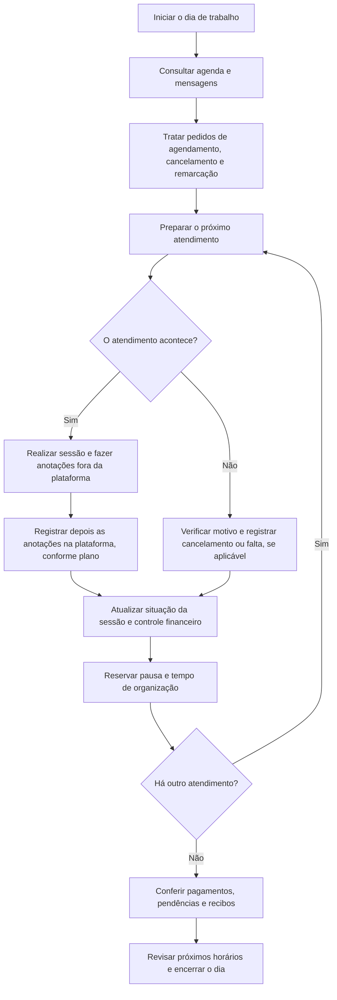

# Rotina da profissional — Clínica Acolher

**Situação:** mapeamento inicial, pendente de validação com a cliente piloto.  
**Objetivo:** entender como ela organiza agenda, cobranças e anotações hoje e identificar as três tarefas que mais consomem tempo ou causam dificuldades.  
**Fontes:** entrevista registrada na seção 16 de [Regras de negócio](Regras%20de%20negocio.md) e informação preliminar sobre o horário de trabalho.

Não há dados reais de pacientes neste documento. As respostas conhecidas descrevem principalmente a operação planejada; ainda não comprovam como a profissional trabalha hoje. Se ela ainda não iniciou os atendimentos, registrar isso e tratar as dificuldades como hipóteses a observar no piloto.

## Informações já levantadas

| Tema | Informação | Situação |
| --- | --- | --- |
| Gestão | A própria profissional cuidará da agenda e do financeiro, sem secretaria. | Relatado na entrevista como plano inicial. |
| Equipe | Inicialmente, apenas uma profissional. | Relatado na entrevista. |
| Sessões | Duração de 50 a 60 minutos. | Relatado na entrevista. |
| Frequência | Em geral, uma sessão por semana; mais vezes quando necessário. | Relatado na entrevista. |
| Cobrança | Por sessão, mensalidade e pacotes; Pix e cartão. | Modalidades pretendidas relatadas na entrevista. |
| Anotações | Durante a sessão, fora da plataforma; depois, registradas nela. | Rotina pretendida relatada na entrevista. |
| Recibos | Inicialmente, recibos como pessoa física. | Intenção relatada; processo de emissão ainda não detalhado. |
| Preocupações | Comprometimento dos pacientes e captação de novos pacientes. | Relatadas, mas não classificadas como as três maiores dores operacionais. |

## Horários planejados — a confirmar

| Item | Informação preliminar |
| --- | --- |
| Dias de trabalho | Segunda a sexta-feira — a confirmar com a profissional. |
| Janela de trabalho | Das 9h às 18h — a confirmar com a profissional. |
| Fuso horário | A confirmar, inclusive para comunicar horários a pacientes no exterior. |
| Almoço | Horário e duração ainda não informados. |
| Intervalo entre sessões | Ainda não informado. |
| Tempo para anotações e administração | Ainda não informado. |

A janela de trabalho não equivale a disponibilidade contínua para sessões. Não calcular capacidade diária nem abrir todos os horários antes de definir almoço, pausas e tempo administrativo.

## Fluxo inicial do dia de trabalho

O desenho abaixo é uma proposta para orientar a conversa. A ordem das tarefas e o momento das cobranças precisam ser ajustados à rotina real.

**Cuidados ao interpretar o fluxo:**

- Pagamentos podem acontecer antes da sessão, depois ou por fechamento, conforme o combinado; isso ainda precisa ser detalhado.
- Cancelamento ou falta não significa cobrança automática. A política e o aceite precisam ser considerados.
- Falha técnica precisa ser distinguida de ausência do paciente.
- Anotações na plataforma são uma intenção de uso. Seu uso com dados reais depende dos requisitos de proteção e auditoria previstos no projeto.

## Como funciona hoje — perguntas para a entrevista

| Área | Perguntas | Resposta sobre a rotina atual |
| --- | --- | --- |
| Início da operação | Você já atende ou está preparando o início dos atendimentos? | Pendente. |
| Agenda | Onde guarda os horários hoje? Como confirma, cancela e remarca? | Pendente. |
| Comunicação | Por onde chegam pedidos e dúvidas? Em quais momentos do dia você responde? | Pendente. |
| Cobranças | Como sabe quem pagou e quem está devendo? Como controla mensalidades e pacotes? | Pendente. |
| Recibos | Como emite e entrega os recibos? O paciente precisa pedir? | Pendente. |
| Anotações | Onde escreve e guarda as anotações hoje? Como encontra as informações antes de atender? | Pendente. |
| Tempo | Qual tarefa toma mais tempo? Quantas vezes ela acontece e quanto costuma durar? | Pendente. |
| Retrabalho | Em quais tarefas precisa conferir, copiar informações ou corrigir erros? | Pendente. |
| Horários | Confirma segunda a sexta, das 9h às 18h? Qual o almoço, as pausas e o tempo administrativo? | Pendente. |

Peça exemplos fictícios de situações, sem nomes, contatos, informações clínicas ou documentos de pacientes. Se possível, anote a frequência e uma estimativa de tempo das tarefas, indicando quando forem apenas estimativas.

## Hipóteses de dificuldades — ainda não confirmadas

| Hipótese | O que perguntar para verificar |
| --- | --- |
| Muitas mensagens para combinar ou alterar horários. | Isso acontece hoje? Com que frequência? Quanto tempo toma? |
| Conferência manual de pagamentos e cobranças pendentes. | Qual ferramenta usa? Há esquecimentos ou necessidade de conferir a mesma informação várias vezes? |
| Tempo para organizar e localizar anotações. | É difícil encontrar o registro anterior? Há duplicação de trabalho? |

Essas hipóteses não são as três maiores dores identificadas. Captação e comprometimento foram preocupações relatadas, mas é necessário entender seus efeitos na rotina e pedir que a profissional priorize os problemas.

## As três maiores dores — preencher após validação

Pergunta principal: **“Quais são as três tarefas ou situações que mais tomam seu tempo ou causam problemas no dia a dia?”**

| Prioridade | Dor nas palavras da profissional | Etapa do fluxo | Frequência e tempo estimado | Impacto e exemplo fictício |
| --- | --- | --- | --- | --- |
| 1 | A identificar. | A preencher. | A preencher. | A preencher. |
| 2 | A identificar. | A preencher. | A preencher. | A preencher. |
| 3 | A identificar. | A preencher. | A preencher. | A preencher. |

Depois da conversa, marque no fluxograma as etapas associadas às dores 1, 2 e 3. Registre a dificuldade antes de propor uma funcionalidade para resolvê-la.

## Registro de validação

| Campo | Registro |
| --- | --- |
| Data | Pendente. |
| Participante | Cliente piloto, sem dados de pacientes. |
| Já atende ou está começando? | Pendente. |
| Fluxo corresponde à rotina atual? | Pendente. |
| Horário de trabalho confirmado? | Pendente. |
| Ajustes solicitados | Pendente. |
| Três maiores dores confirmadas? | Pendente. |

## Acompanhamento da tarefa

- [x] Fluxo inicial desenhado como proposta.
- [x] Informações conhecidas e pendências separadas.
- [x] Resultado registrado em `docs/`, sem dados reais de pacientes.
- [ ] Fluxo ajustado à rotina atual ou explicitamente validado como rotina planejada, caso ela ainda não atenda.
- [ ] Três maiores dores identificadas com a profissional e marcadas no fluxo.

**A tarefa permanece pendente de validação.** Este documento prepara a entrevista; não substitui as respostas sobre a rotina atual e as três maiores dificuldades.
